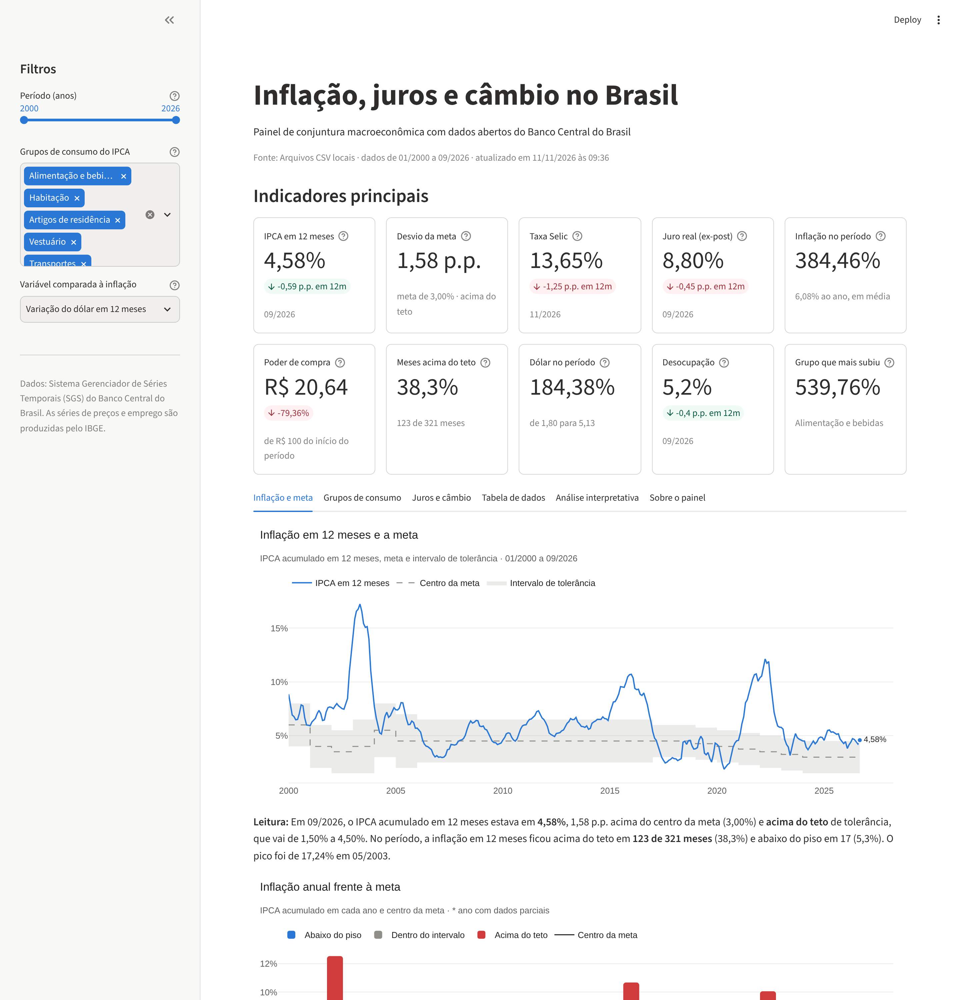

# Inflação, juros e câmbio no Brasil

Sistema de análise de dados e dashboard interativo com dados abertos do Banco Central do
Brasil, desenvolvido em Python com Programação Orientada a Objetos, Pandas, Plotly e Streamlit.

Projeto final da disciplina de Programação Orientada a Objetos — Ciência de Dados e
Inteligência Artificial.



**Documentação completa:** <https://augustolamounier.github.io/painel-macroeconomico-bcb/>

## O problema

> A inflação brasileira tem ficado dentro da meta? O que explica os períodos em que ela
> escapou, como os juros reagiram e quanto isso custou em poder de compra?

O painel consulta a API pública de séries temporais do Banco Central (SGS), trata os dados e
responde a seis perguntas:

1. A inflação tem ficado dentro da meta? Em que períodos estourou o teto?
2. Quais grupos de consumo mais encareceram?
3. Como a Selic reagiu à inflação? O juro real foi positivo?
4. A alta do dólar anda junto com a inflação?
5. Quanto poder de compra o real perdeu desde 2000?
6. Existe padrão sazonal na inflação?

## Como executar

Requer Python 3.11 ou mais recente.

```bash
git clone https://github.com/augustolamounier/painel-macroeconomico-bcb.git
cd painel-macroeconomico-bcb

python -m venv .venv
source .venv/bin/activate          # no Windows: .venv\Scripts\activate
pip install -r requirements.txt

streamlit run app.py
```

O painel abre em <http://localhost:8501>. Ele consulta a API do Banco Central a cada seis
horas; se a API não responder, usa a cópia local dos dados em `data/raw/`.

| Comando | O que faz |
|---|---|
| `streamlit run app.py` | Abre o dashboard |
| `PAINEL_FONTE=csv streamlit run app.py` | Abre o dashboard sem internet (só a cópia local) |
| `python scripts/atualizar_dados.py` | Baixa as séries e atualiza a pasta `data/` |
| `pytest` | Executa os testes (requer `pip install -r requirements-dev.txt`) |
| `mkdocs serve` | Abre a documentação localmente |

## O que o dashboard tem

- **Cabeçalho** com a fonte, o período coberto e o horário da atualização.
- **Dez indicadores (KPIs):** IPCA em 12 meses, desvio da meta, Selic, juro real, inflação
  acumulada, poder de compra, meses acima do teto, variação do dólar, desocupação e o grupo
  que mais encareceu.
- **Filtros interativos:** período, grupos do IPCA e variável comparada à inflação.
- **Nove gráficos Plotly:** linhas, barras, setores, dispersão, boxplot e mapa de calor.
- **Tabela de dados** com escolha de colunas, ordenação e download em CSV.
- **Análise interpretativa** gerada a partir dos números do período selecionado.

## Arquitetura

O código fica no pacote `painel_macro`, em que cada classe tem uma única responsabilidade:

```text
FonteDados ──► PipelineDados ──► TratadorDados ──► AnalisadorDados ──┬─► PainelIndicadores ─┐
(API ou CSV)                                                         ├─► GaleriaGraficos ───┼─► Dashboard
                                                                     └─► GeradorInterpretacao┘
```

| Classe | Responsabilidade |
|---|---|
| `FonteDados` *(abstrata)* → `FonteDadosSGS`, `FonteDadosCSV`, `FonteDadosComCache` | Gerenciar a origem dos dados |
| `TratadorDados` | Converter tipos, remover duplicidades e tratar valores ausentes |
| `AnalisadorDados` | Filtrar, agrupar, ordenar e calcular estatísticas |
| `Indicador` *(abstrata)* → sete subclasses | Representar os indicadores calculados |
| `Visualizador` *(abstrata)* → seis subclasses | Gerar os gráficos |
| `Dashboard` | Organizar os componentes do painel |

Conceitos de POO aplicados: classes abstratas, herança (três hierarquias), polimorfismo,
encapsulamento com `@property` e os cinco princípios SOLID. O detalhamento, com diagrama de
classes, está na [documentação](https://augustolamounier.github.io/painel-macroeconomico-bcb/arquitetura/).

## Estrutura do repositório

```text
├── app.py                 # ponto de entrada do dashboard
├── painel_macro/          # classes do sistema
├── scripts/               # atualização dos dados, notebook e gráficos da documentação
├── notebooks/             # análise exploratória dos dados
├── data/raw/              # cópia dos dados brutos (um CSV por série)
├── data/processed/        # base mensal tratada
├── tests/                 # 77 testes automatizados
├── docs/                  # fonte da documentação (publicada no branch gh-pages)
├── requirements.txt       # dependências do painel
└── requirements-dev.txt   # dependências de testes e documentação
```

## Fonte dos dados

[Banco Central do Brasil — Sistema Gerenciador de Séries Temporais (SGS)](https://dadosabertos.bcb.gov.br/),
pela API `https://api.bcb.gov.br/dados/serie/bcdata.sgs.{código}/dados`. Séries utilizadas:
433, 13522, 4189, 3698, 24369, 24363, 13521 e 1635 a 1643. O IPCA e a taxa de desocupação são
produzidos pelo IBGE e redistribuídos pelo Banco Central.

## Testes

```bash
pip install -r requirements-dev.txt
pytest --cov=painel_macro
```

São 77 testes (unitários e de integração), com 95% de cobertura. Eles não acessam a internet.

## Autor

Augusto Lamounier
