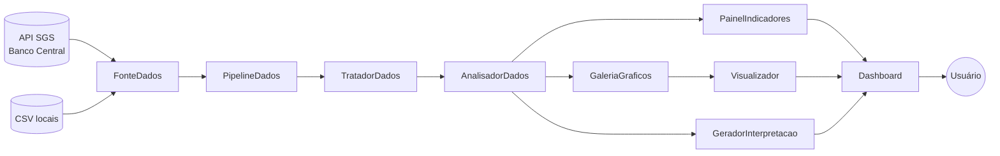

# 3. Arquitetura orientada a objetos

## Visão geral

O sistema é um pacote Python (`painel_macro`) em que cada módulo tem uma única
responsabilidade. Os dados percorrem um caminho de mão única:



| Camada | Módulo | Pergunta que responde |
|---|---|---|
| Configuração | `config.py` | *Quais* séries o projeto usa? |
| Origem | `fontes.py` | *De onde* vêm os dados? |
| Tratamento | `tratamento.py`, `pipeline.py` | Como os dados brutos viram uma base confiável? |
| Análise | `analisador.py` | Que consultas e cálculos a base permite? |
| Indicadores | `indicadores.py` | Que números-resumo interessam ao problema? |
| Visualização | `visualizadores.py`, `galeria.py` | Como cada resultado é desenhado? |
| Interpretação | `interpretacao.py` | O que os números significam, em palavras? |
| Apresentação | `dashboard.py`, `app.py` | Como tudo é organizado na tela? |

## Diagrama de classes

```mermaid
classDiagram
    direction TB

    class FonteDados {
        <<abstract>>
        -_nome: str
        +nome: str
        +carregar(serie, inicio, fim)* DataFrame
        +carregar_varias(series, inicio, fim) DataFrame
    }
    class FonteDadosSGS {
        -_cliente: ClienteHTTP
        -_janela_anos: int
        +carregar(serie, inicio, fim) DataFrame
        -_janelas(serie, inicio, fim) list
    }
    class FonteDadosCSV {
        -_diretorio: Path
        +carregar(serie, inicio, fim) DataFrame
        +salvar(serie, dados) Path
        +possui(serie) bool
    }
    class FonteDadosComCache {
        -_principal: FonteDados
        -_reserva: FonteDadosCSV
        +usou_reserva: bool
        +carregar(serie, inicio, fim) DataFrame
    }
    class ClienteHTTP {
        <<interface>>
        +obter_json(url, parametros) list
    }
    class ClienteRequests {
        -_sessao: Session
        -_tentativas: int
        +obter_json(url, parametros) list
    }

    FonteDados <|-- FonteDadosSGS
    FonteDados <|-- FonteDadosCSV
    FonteDados <|-- FonteDadosComCache
    FonteDadosComCache o-- FonteDados : principal
    FonteDadosComCache o-- FonteDadosCSV : reserva
    FonteDadosSGS o-- ClienteHTTP
    ClienteHTTP <|.. ClienteRequests

    class PipelineDados {
        -_fonte: FonteDados
        -_tratador: TratadorDados
        +executar(inicio, fim) DataFrame
        +relatorio: RelatorioQualidade
    }
    class TratadorDados {
        -_relatorio: RelatorioQualidade
        +tratar(bruto) DataFrame
        +relatorio: RelatorioQualidade
    }
    class AnalisadorDados {
        -_dados: DataFrame
        -_tolerancia_meta: float
        +dados: DataFrame
        +filtrar_periodo(inicio, fim) AnalisadorDados
        +inflacao_por_ano() DataFrame
        +inflacao_por_grupo(grupos) DataFrame
        +estatisticas_descritivas(colunas) DataFrame
        +tendencia_linear(x, y) dict
    }
    PipelineDados o-- FonteDados
    PipelineDados o-- TratadorDados

    class Indicador {
        <<abstract>>
        -_nome: str
        -_descricao: str
        -_unidade: str
        +calcular(analisador)* ResultadoIndicador
    }
    class IndicadorUltimoValor
    class IndicadorInflacaoAcumulada
    class IndicadorPoderDeCompra
    class IndicadorDesvioMeta
    class IndicadorMesesAcimaDoTeto
    class IndicadorVariacaoNoPeriodo
    class IndicadorGrupoMaiorInflacao
    class PainelIndicadores {
        -_indicadores: list~Indicador~
        +adicionar(indicador)
        +calcular_todos(analisador) list
    }
    Indicador <|-- IndicadorUltimoValor
    Indicador <|-- IndicadorInflacaoAcumulada
    Indicador <|-- IndicadorPoderDeCompra
    Indicador <|-- IndicadorDesvioMeta
    Indicador <|-- IndicadorMesesAcimaDoTeto
    Indicador <|-- IndicadorVariacaoNoPeriodo
    Indicador <|-- IndicadorGrupoMaiorInflacao
    PainelIndicadores o-- Indicador
    Indicador ..> AnalisadorDados : usa

    class Visualizador {
        <<abstract>>
        -_titulo: str
        -_tema: TemaGrafico
        +gerar(dados) Figure
        #_construir(dados)* Figure
    }
    class GraficoLinhas
    class GraficoBarras
    class GraficoSetores
    class GraficoDispersao
    class GraficoBoxplot
    class GraficoMapaCalor
    class GaleriaGraficos {
        -_analisador: AnalisadorDados
        +gerar(nome) Figure
        +gerar_todos() dict
    }
    Visualizador <|-- GraficoLinhas
    Visualizador <|-- GraficoBarras
    Visualizador <|-- GraficoSetores
    Visualizador <|-- GraficoDispersao
    Visualizador <|-- GraficoBoxplot
    Visualizador <|-- GraficoMapaCalor
    GaleriaGraficos ..> Visualizador : cria
    GaleriaGraficos o-- AnalisadorDados

    class Dashboard {
        -_analisador: AnalisadorDados
        -_painel_indicadores: PainelIndicadores
        -_informacoes: InformacoesCarga
        +renderizar()
    }
    Dashboard o-- AnalisadorDados
    Dashboard o-- PainelIndicadores
    Dashboard ..> GaleriaGraficos : cria
    Dashboard ..> GeradorInterpretacao : cria
```



## Classes implementadas e suas responsabilidades

### Origem dos dados — `fontes.py`

| Classe | Responsabilidade |
|---|---|
| `FonteDados` *(abstrata)* | Define o contrato de qualquer origem: `carregar(serie, inicio, fim)`. Implementa `carregar_varias`, que funciona para todas as subclasses. |
| `FonteDadosSGS` | Consulta a API do Banco Central; divide consultas de séries diárias em janelas de dez anos. |
| `FonteDadosCSV` | Lê e grava as séries em arquivos CSV locais. |
| `FonteDadosComCache` | Envolve duas fontes: tenta a principal e, se ela falhar, usa a reserva (padrão *Decorator*). |
| `ClienteHTTP` *(protocolo)* | Interface mínima de acesso à rede: um único método, `obter_json`. |
| `ClienteRequests` | Implementa `ClienteHTTP` com a biblioteca `requests`, com novas tentativas em caso de erro passageiro. |

### Tratamento — `tratamento.py` e `pipeline.py`

| Classe | Responsabilidade |
|---|---|
| `TratadorDados` | Converte tipos, remove duplicidades e datas futuras, monta a base mensal e trata ausentes. |
| `RelatorioQualidade` | Guarda a contagem do que foi verificado e corrigido. |
| `PipelineDados` | Liga uma fonte a um tratador e devolve a base pronta. |

### Análise — `analisador.py`

| Classe | Responsabilidade |
|---|---|
| `AnalisadorDados` | Encapsula a base mensal e oferece filtros, agrupamentos, ordenações e estatísticas. Não desenha nem exibe nada. |

### Indicadores — `indicadores.py`

| Classe | Responsabilidade |
|---|---|
| `Indicador` *(abstrata)* | Contrato comum: `calcular(analisador)` devolve um `ResultadoIndicador`. |
| `IndicadorUltimoValor` | Último valor de uma variável e variação em 12 meses (usado para IPCA, Selic, juro real e desocupação). |
| `IndicadorInflacaoAcumulada` | Inflação composta do período. |
| `IndicadorPoderDeCompra` | Valor real de R$ 100 ao final do período. |
| `IndicadorDesvioMeta` | Distância entre a inflação e o centro da meta. |
| `IndicadorMesesAcimaDoTeto` | Percentual de meses acima do teto da meta. |
| `IndicadorVariacaoNoPeriodo` | Variação percentual de uma variável entre o início e o fim (usado para o dólar). |
| `IndicadorGrupoMaiorInflacao` | Grupo do IPCA que mais encareceu. |
| `ResultadoIndicador` | Objeto de valor imutável com o número calculado e sua formatação. |
| `PainelIndicadores` | Coleção de indicadores; calcula todos de uma vez. |

### Visualização — `visualizadores.py` e `galeria.py`

| Classe | Responsabilidade |
|---|---|
| `Visualizador` *(abstrata)* | Define `gerar(dados)`: valida, delega o desenho a `_construir` e aplica o tema. |
| `GraficoLinhas`, `GraficoBarras`, `GraficoSetores`, `GraficoDispersao`, `GraficoBoxplot`, `GraficoMapaCalor` | Cada uma desenha um tipo de gráfico, implementando apenas `_construir`. |
| `TemaGrafico` | Cores, fontes e margens comuns a todos os gráficos. |
| `GaleriaGraficos` | Decide quais gráficos o painel tem e com que dados do analisador cada um é alimentado. |

### Interpretação e apresentação

| Classe | Responsabilidade |
|---|---|
| `GeradorInterpretacao` | Transforma os números do período filtrado em frases (análise interpretativa). |
| `Dashboard` | Organiza cabeçalho, filtros, KPIs, gráficos, tabela e textos na página Streamlit. |
| `Filtros`, `InformacoesCarga` | Objetos de valor com as escolhas do usuário e os dados da carga. |

## Requisitos de POO do enunciado

| Requisito | Como foi atendido |
|---|---|
| Pelo menos quatro classes | Mais de 25 classes, sendo três hierarquias com classe base abstrata. |
| Construtores `__init__` | Todas as classes de comportamento têm construtor explícito; as de dados usam `@dataclass`, que gera o `__init__`. |
| Atributos e métodos | Ex.: `AnalisadorDados` tem os atributos `_dados` e `_tolerancia_meta` e mais de quinze métodos públicos. |
| Criação e uso de objetos | `app.py` instancia a fonte, o pipeline, o analisador, o painel de indicadores e o dashboard. |
| Encapsulamento | Atributos internos com prefixo `_` e acesso por `@property` somente leitura; `AnalisadorDados.dados` devolve uma **cópia**, de modo que ninguém altera a base por fora. |
| Herança | `FonteDados` → 3 subclasses; `Indicador` → 7 subclasses; `Visualizador` → 6 subclasses. |
| Polimorfismo | `PainelIndicadores.calcular_todos` chama `calcular` em objetos de classes diferentes; `Visualizador.gerar` chama o `_construir` da subclasse; `PipelineDados` aceita qualquer `FonteDados`. |
| Abstração | Classes base declaradas com `ABC` e `@abstractmethod`; não podem ser instanciadas. |

### Demonstração de criação e uso de objetos

```python
from painel_macro.fontes import FonteDadosSGS, FonteDadosCSV, FonteDadosComCache
from painel_macro.pipeline import PipelineDados
from painel_macro.analisador import AnalisadorDados
from painel_macro.indicadores import PainelIndicadores
from painel_macro.galeria import GaleriaGraficos

# 1. objetos de origem: a API, com a cópia local como reserva
fonte = FonteDadosComCache(FonteDadosSGS(), FonteDadosCSV("data/raw"))

# 2. carga e tratamento
base = PipelineDados(fonte).executar()

# 3. análise de um período
analisador = AnalisadorDados(base).filtrar_periodo("2015-01-01", "2024-12-01")

# 4. indicadores — polimorfismo: cada objeto calcula do seu jeito
for resultado in PainelIndicadores.padrao().calcular_todos(analisador):
    print(resultado.nome, resultado.valor_formatado)

# 5. um gráfico
GaleriaGraficos(analisador).inflacao_e_meta().show()
```

### Encapsulamento em detalhe

```python
class AnalisadorDados:
    def __init__(self, base, tolerancia_meta=None):
        self._tolerancia_meta = tolerancia_meta      # atributo interno
        self._dados = self._enriquecer(base)         # estado protegido

    @property
    def dados(self) -> pd.DataFrame:
        """Cópia da base analisada — o estado interno não é exposto."""
        return self._dados.copy()
```

O teste `test_encapsulamento_dados_devolve_copia` comprova o comportamento: alterar o
`DataFrame` devolvido por `analisador.dados` não muda o que o analisador guarda.

### Polimorfismo em detalhe

```python
class PainelIndicadores:
    def calcular_todos(self, analisador):
        return [indicador.calcular(analisador) for indicador in self._indicadores]
```

O painel não tem nenhum `if` sobre o tipo do indicador: a chamada `indicador.calcular(...)`
executa o método da classe concreta de cada objeto.

## Princípios SOLID

### S — Responsabilidade única

Cada classe tem um só motivo para mudar. `FonteDadosSGS` só muda se a API mudar;
`TratadorDados`, se as regras de limpeza mudarem; `Visualizador`, se a aparência mudar. O
`AnalisadorDados` não conhece o Plotly nem o Streamlit, e os visualizadores não fazem cálculo —
recebem tabelas prontas.

### O — Aberto/fechado

O sistema é estendido **acrescentando** classes, sem modificar as existentes:

- novo indicador → nova subclasse de `Indicador`, incluída com `painel.adicionar(...)`;
- novo tipo de gráfico → nova subclasse de `Visualizador`;
- nova origem de dados → nova subclasse de `FonteDados`;
- nova série do Banco Central → um item a mais no catálogo de `config.py`.

O teste `test_painel_aceita_novos_indicadores_sem_modificacao` cria um indicador novo dentro
do próprio teste e mostra que o painel o aceita sem nenhuma alteração.

### L — Substituição de Liskov

Qualquer subclasse pode ocupar o lugar da classe base. `PipelineDados` funciona igualmente com
`FonteDadosSGS`, `FonteDadosCSV`, `FonteDadosComCache` ou com a `FonteFalsa` dos testes, porque
todas devolvem um `DataFrame` com as mesmas colunas e levantam o mesmo tipo de erro
(`ErroFonteDados`). O teste parametrizado `test_todo_visualizador_lida_com_dados_vazios`
verifica que as seis subclasses de `Visualizador` respondem da mesma forma a dados vazios.

### I — Segregação de interfaces

As interfaces são pequenas. `ClienteHTTP` tem um único método (`obter_json`), que é tudo de
que `FonteDadosSGS` precisa — a fonte não depende da interface inteira da biblioteca
`requests`. `Indicador` exige apenas `calcular`; `Visualizador`, apenas `_construir`.

### D — Inversão de dependência

As classes de alto nível dependem de abstrações, recebidas pelo construtor (injeção de
dependência):

- `PipelineDados` recebe uma `FonteDados` — não sabe se é API ou arquivo;
- `FonteDadosSGS` recebe um `ClienteHTTP` — nos testes, um cliente falso substitui a rede;
- `Dashboard` recebe o `AnalisadorDados` e o `PainelIndicadores` já prontos.

As classes concretas são escolhidas em um único lugar, o `app.py` (a "raiz de composição").

## Padrões de projeto utilizados

| Padrão | Onde | Para quê |
|---|---|---|
| *Template Method* | `Visualizador.gerar` → `_construir` | Fixar a sequência validar → desenhar → aplicar tema, variando só o desenho. |
| *Strategy* | Subclasses de `Indicador` | Trocar a regra de cálculo sem alterar quem a usa. |
| *Decorator* | `FonteDadosComCache` | Acrescentar a cópia de segurança a qualquer fonte, sem alterá-la. |
| Injeção de dependência | Construtores | Permitir testes sem rede e a troca de implementações. |
| Objeto de valor | `SerieConfig`, `ResultadoIndicador`, `Filtros` | Dados imutáveis (`@dataclass(frozen=True)`). |

## Estrutura do repositório

```text
painel-macroeconomico-bcb/
├── app.py                     # ponto de entrada do dashboard
├── painel_macro/              # pacote com as classes do sistema
│   ├── config.py              # catálogo de séries
│   ├── fontes.py              # FonteDados e subclasses
│   ├── tratamento.py          # TratadorDados
│   ├── pipeline.py            # PipelineDados
│   ├── analisador.py          # AnalisadorDados
│   ├── indicadores.py         # Indicador e subclasses
│   ├── visualizadores.py      # Visualizador e subclasses
│   ├── galeria.py             # GaleriaGraficos
│   ├── interpretacao.py       # GeradorInterpretacao
│   └── dashboard.py           # Dashboard
├── scripts/                   # atualização dos dados, notebook e gráficos da documentação
├── notebooks/                 # análise exploratória (Etapa 2)
├── data/raw/                  # cópia dos dados brutos (um CSV por série)
├── data/processed/            # base mensal tratada
├── tests/                     # testes automatizados
├── docs/                      # fonte desta documentação (MkDocs)
└── requirements.txt
```
