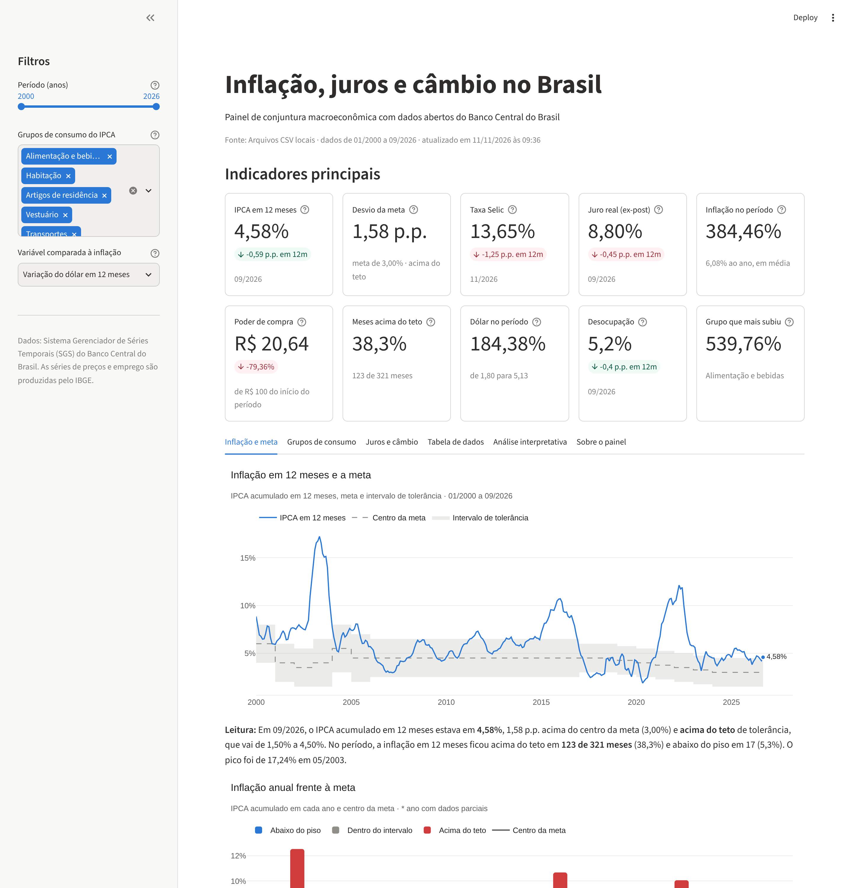
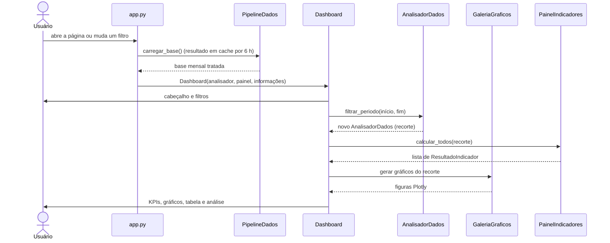

# 6. Dashboard

O dashboard é uma aplicação web feita com **Streamlit**. Ele reúne, em uma única página, os
seis componentes exigidos no enunciado.

<figure markdown>
  
  <figcaption>Dashboard com o período completo selecionado.</figcaption>
</figure>

## Componentes

| Requisito | Onde está | Método da classe `Dashboard` |
|---|---|---|
| **Cabeçalho** | Título, subtítulo, fonte dos dados, período coberto e horário da atualização | `_cabecalho` |
| **Indicadores principais (KPIs)** | Dez cartões no topo, com valor, variação em 12 meses e texto de apoio | `_indicadores` |
| **Filtros interativos** | Barra lateral: período, grupos do IPCA e variável comparada à inflação | `_filtros` |
| **Visualizações dinâmicas** | Nove gráficos Plotly distribuídos em três abas | `_aba_inflacao`, `_aba_grupos`, `_aba_juros_cambio` |
| **Tabela de dados** | Aba própria, com escolha de colunas, ordenação e download em CSV | `_aba_tabela` |
| **Análise interpretativa** | Frase de "Leitura" abaixo de cada gráfico e aba com a análise completa | `_leitura`, `_aba_interpretacao` |

## Filtros

| Filtro | Tipo | Efeito |
|---|---|---|
| **Período (anos)** | Controle deslizante com dois extremos | Recalcula **tudo**: indicadores, gráficos, tabela e textos |
| **Grupos de consumo do IPCA** | Seleção múltipla | Define os grupos exibidos nas barras e no boxplot, e o indicador "Grupo que mais subiu" na análise |
| **Variável comparada à inflação** | Lista de opções | Troca o eixo horizontal do gráfico de dispersão (dólar, Selic, desocupação ou IBC-Br) |

Na aba *Tabela de dados* há ainda três controles locais: as variáveis exibidas, a coluna de
ordenação e o sentido (crescente ou decrescente).

## Abas

1. **Inflação e meta** — linha do IPCA em 12 meses com o intervalo da meta; barras da inflação
   anual; setores com a parcela de meses dentro e fora da meta; mapa de calor da sazonalidade.
2. **Grupos de consumo** — barras com a inflação acumulada por grupo e boxplot das variações
   mensais.
3. **Juros e câmbio** — linhas de Selic, inflação e juro real; linha do dólar; dispersão entre
   a variável escolhida e a inflação.
4. **Tabela de dados** — tabela filtrável e ordenável, botão de download, estatísticas
   descritivas e relatório de qualidade dos dados.
5. **Análise interpretativa** — texto completo, gerado a partir dos números do período
   selecionado, e as limitações da análise.
6. **Sobre o painel** — descrição das variáveis e de como ler os indicadores.

## Como funciona por dentro

O Streamlit executa o arquivo `app.py` do início ao fim a cada interação do usuário. O fluxo
é o seguinte:



Pontos importantes:

- **Cache.** A consulta à API é decorada com `st.cache_data(ttl=6 h)`: os dados são baixados
  uma vez e reaproveitados nas interações seguintes, o que deixa os filtros instantâneos.
- **Tolerância a falhas.** Se a API do Banco Central não responder, o painel usa a cópia
  local em `data/raw/` e avisa o usuário no cabeçalho.
- **Imutabilidade.** `filtrar_periodo` devolve um **novo** `AnalisadorDados`; a base completa
  nunca é alterada, de modo que os filtros não interferem uns nos outros.
- **Texto dinâmico.** A análise interpretativa é montada pelo `GeradorInterpretacao` a partir
  dos números do recorte. Ao mudar o período, o texto muda junto.

## Como executar

Requer Python 3.11 ou mais recente.

```bash
git clone https://github.com/augustolamounier/painel-macroeconomico-bcb.git
cd painel-macroeconomico-bcb

python -m venv .venv
source .venv/bin/activate          # no Windows: .venv\Scripts\activate
pip install -r requirements.txt

streamlit run app.py
```

O painel abre em `http://localhost:8501`.

| Comando | O que faz |
|---|---|
| `streamlit run app.py` | Abre o dashboard consultando a API (com a cópia local como reserva) |
| `PAINEL_FONTE=csv streamlit run app.py` | Abre o dashboard usando apenas a cópia local (sem internet) |
| `python scripts/atualizar_dados.py` | Baixa as séries e atualiza `data/raw/` e `data/processed/` |
| `python scripts/exportar_graficos.py` | Regera os gráficos desta documentação |
| `python scripts/gerar_notebook.py` | Regera e executa o notebook de exploração |
| `pytest` | Executa os testes |

No Windows (PowerShell), a variável de ambiente é definida com
`$env:PAINEL_FONTE="csv"; streamlit run app.py`.

## Publicação na internet

O dashboard pode ser publicado gratuitamente no **Streamlit Community Cloud**: basta entrar em
[share.streamlit.io](https://share.streamlit.io/) com a conta do GitHub, escolher este
repositório, o branch `main` e o arquivo `app.py`. As dependências são lidas de
`requirements.txt`.
