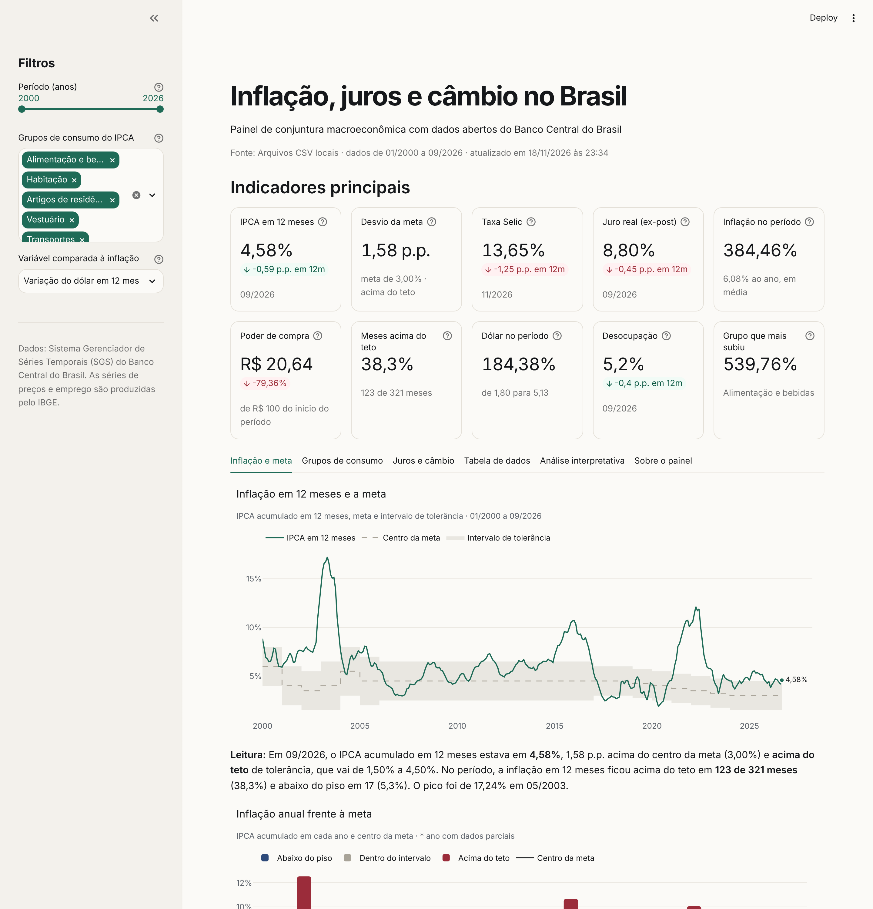
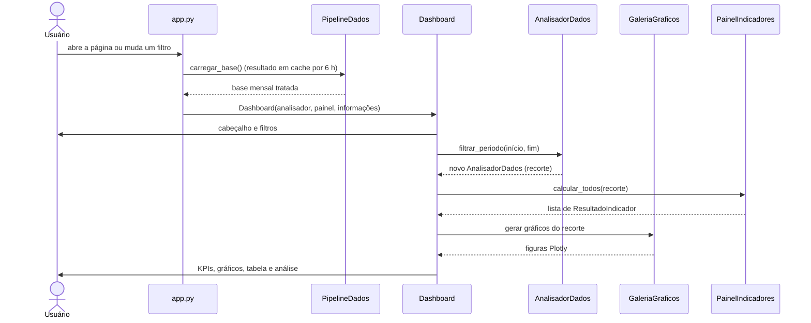

# 6. Dashboard

O dashboard é uma aplicação web feita com **Streamlit**. Ele reúne, em uma única página, os
seis componentes exigidos no enunciado.

<figure markdown>
  
  <figcaption>Dashboard com o período completo selecionado.</figcaption>
</figure>

## Componentes

| Requisito | Onde está | Método da classe `Dashboard` |
|---|---|---|
| **Cabeçalho** | Título, subtítulo, fonte dos dados, período coberto e horário da atualização | `_cabecalho` |
| **Indicadores principais (KPIs)** | Dez cartões no topo, com valor, variação em 12 meses e texto de apoio | `_indicadores` |
| **Filtros interativos** | Barra lateral: período, grupos do IPCA e variável comparada à inflação | `_filtros` |
| **Visualizações dinâmicas** | Nove gráficos Plotly distribuídos em três abas | `_aba_inflacao`, `_aba_grupos`, `_aba_juros_cambio` |
| **Tabela de dados** | Aba própria, com escolha de colunas, ordenação e download em CSV | `_aba_tabela` |
| **Análise interpretativa** | Frase de "Leitura" abaixo de cada gráfico e aba com a análise completa | `_leitura`, `_aba_interpretacao` |

## Identidade visual

O dashboard, os gráficos, esta documentação e a apresentação usam a mesma paleta,
definida em `.streamlit/config.toml` (tema do Streamlit) e em `TemaGrafico` (gráficos Plotly):

| Papel | Cor | Uso |
|---|---|---|
| Fundo | `#FBFAF7` | off-white quente, mais confortável que o branco puro |
| Texto | `#16181B` | grafite, contraste alto sem o preto absoluto |
| Principal | `#1F6B57` (jade) | IPCA, destaques e controles |
| Séries de apoio | `#B8862B` (latão) e `#6B4C9A` (ameixa) | segunda e terceira séries dos gráficos de linhas |
| Situação frente à meta | `#2E4A7A`, `#A8A398` e `#9B2C3A` | abaixo do piso, dentro do intervalo e acima do teto |

As cores das séries foram conferidas por simulação de daltonismo (protanopia,
deuteranopia e tritanopia) e têm contraste mínimo de 3:1 com o fundo. Títulos usam
espaçamento entre letras levemente negativo e os números usam algarismos de largura
fixa, para que os valores não "pulem" quando mudam com os filtros.

## Filtros

| Filtro | Tipo | Efeito |
|---|---|---|
| **Período (anos)** | Controle deslizante com dois extremos | Recalcula **tudo**: indicadores, gráficos, tabela e textos |
| **Grupos de consumo do IPCA** | Seleção múltipla | Define os grupos exibidos nas barras e no boxplot, e o indicador "Grupo que mais subiu" na análise |
| **Variável comparada à inflação** | Lista de opções | Troca o eixo horizontal do gráfico de dispersão (dólar, Selic, desocupação ou IBC-Br) |

Na aba *Tabela de dados* há ainda três controles locais: as variáveis exibidas, a coluna de
ordenação e o sentido (crescente ou decrescente).

## Abas

1. **Inflação e meta** — linha do IPCA em 12 meses com o intervalo da meta; barras da inflação
   anual; setores com a parcela de meses dentro e fora da meta; mapa de calor da sazonalidade.
2. **Grupos de consumo** — barras com a inflação acumulada por grupo e boxplot das variações
   mensais.
3. **Juros e câmbio** — linhas de Selic, inflação e juro real; linha do dólar; dispersão entre
   a variável escolhida e a inflação.
4. **Tabela de dados** — tabela filtrável e ordenável, botão de download, estatísticas
   descritivas e relatório de qualidade dos dados.
5. **Análise interpretativa** — texto completo, gerado a partir dos números do período
   selecionado, e as limitações da análise.
6. **Sobre o painel** — descrição das variáveis e de como ler os indicadores.

## Como funciona por dentro

O Streamlit executa o arquivo `app.py` do início ao fim a cada interação do usuário. O fluxo
é o seguinte:



Pontos importantes:

- **Cache.** A consulta à API é decorada com `st.cache_data(ttl=6 h)`: os dados são baixados
  uma vez e reaproveitados nas interações seguintes, o que deixa os filtros instantâneos.
- **Tolerância a falhas.** Se a API do Banco Central não responder, o painel usa a cópia
  local em `data/raw/` e avisa o usuário no cabeçalho.
- **Imutabilidade.** `filtrar_periodo` devolve um **novo** `AnalisadorDados`; a base completa
  nunca é alterada, de modo que os filtros não interferem uns nos outros.
- **Texto dinâmico.** A análise interpretativa é montada pelo `GeradorInterpretacao` a partir
  dos números do recorte. Ao mudar o período, o texto muda junto.

## Como executar

!!! warning "O endereço `localhost` só funciona no seu computador"
    `http://localhost:8501` aponta para a sua própria máquina. Ele só abre **depois** que o
    painel é iniciado com os comandos abaixo, e só enquanto o terminal continuar aberto.
    Clicar no endereço sem ter rodado os comandos mostra "não é possível acessar esse site".

Requer **Python 3.11 ou mais recente** (`python --version`). Os comandos não exigem ativar o
ambiente virtual, o que evita o bloqueio de scripts do PowerShell.

=== "Windows"

    ```bat
    git clone https://github.com/augustolamounier/painel-macroeconomico-bcb.git
    cd painel-macroeconomico-bcb
    python -m venv .venv
    .\.venv\Scripts\python -m pip install -r requirements.txt
    .\.venv\Scripts\python -m streamlit run app.py
    ```

=== "macOS e Linux"

    ```bash
    git clone https://github.com/augustolamounier/painel-macroeconomico-bcb.git
    cd painel-macroeconomico-bcb
    python3 -m venv .venv
    .venv/bin/python -m pip install -r requirements.txt
    .venv/bin/python -m streamlit run app.py
    ```

Quando o terminal mostrar `Local URL: http://localhost:8501`, o navegador abre sozinho (se não
abrir, copie o endereço). Para encerrar, aperte `Ctrl + C` no terminal.

O arquivo `.streamlit/config.toml` desliga o pedido de e-mail que o Streamlit faz na primeira
execução. Sem isso, o terminal parava em `Email:` e o painel só abria depois de alguém apertar
Enter — o que parecia um travamento.

### Problemas comuns

| Sintoma | Solução |
|---|---|
| "Não é possível acessar esse site" | O painel não está rodando: execute os comandos e deixe o terminal aberto |
| `No matching distribution found for pandas` | Python anterior ao 3.11: instale o 3.12 ou mais recente |
| `'python' não é reconhecido` (Windows) | Use `py` no lugar de `python` no comando que cria o `.venv` |
| `'streamlit' não é reconhecido` | Use `python -m streamlit`, como nos comandos acima |
| `Port 8501 is already in use` | Acrescente `--server.port 8502` e abra `http://localhost:8502` |

### Outros comandos

Execute-os com o Python do ambiente do projeto (`.\.venv\Scripts\python` no Windows,
`.venv/bin/python` no macOS e Linux).

| Comando | O que faz |
|---|---|
| `python -m streamlit run app.py` | Abre o dashboard consultando a API (com a cópia local como reserva) |
| `python scripts/atualizar_dados.py` | Baixa as séries e atualiza `data/raw/` e `data/processed/` |
| `python scripts/exportar_graficos.py` | Regera os gráficos desta documentação |
| `python scripts/gerar_notebook.py` | Regera e executa o notebook de exploração |
| `python -m pytest` | Executa os testes |

Para usar apenas a cópia local (sem internet), defina `PAINEL_FONTE=csv` antes de rodar:
`$env:PAINEL_FONTE="csv"` no PowerShell ou `export PAINEL_FONTE=csv` no macOS e Linux.

## Publicação na internet

O dashboard está publicado no **Streamlit Community Cloud**, gratuito, e pode ser aberto por
qualquer pessoa, sem instalar nada:

<https://painel-macroeconomico-bcb-xbdm48s6ujnhv8qfbywky2.streamlit.app/>

A versão online lê o código do branch `main` deste repositório e se atualiza sozinha a cada
novo envio ao GitHub. As dependências são lidas de `requirements.txt`.

!!! note "Primeiro acesso depois de alguns dias"
    O Streamlit Community Cloud coloca para dormir os apps que ficam um tempo sem acessos.
    Nesse caso, a página mostra um botão para reativar o painel, que volta em cerca de um
    minuto. Vale abrir o link antes de uma apresentação.
