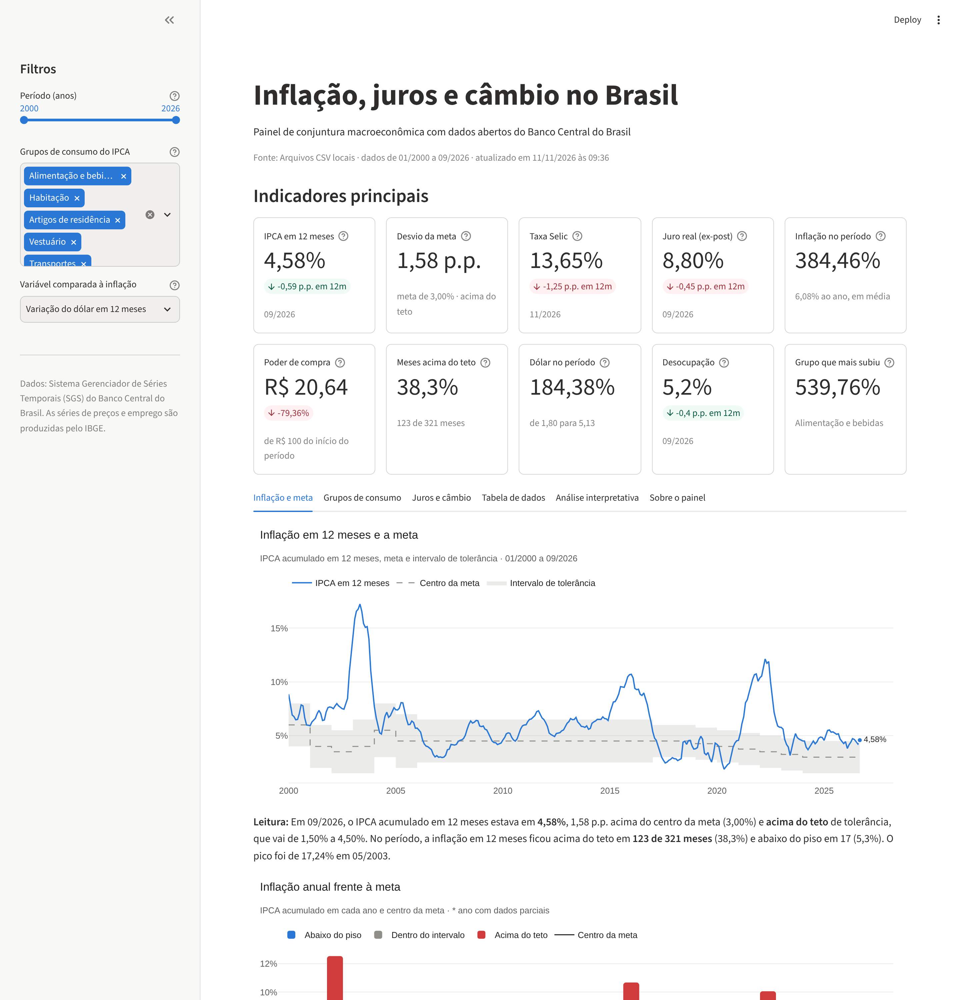

# Inflação, juros e câmbio no Brasil

**Sistema de análise de dados e dashboard interativo com dados abertos do Banco Central do Brasil**

Projeto final da disciplina de Programação Orientada a Objetos — curso de Ciência de Dados e
Inteligência Artificial.

<figure markdown>
  
  <figcaption>Tela inicial do dashboard, com filtros, indicadores e gráficos interativos.</figcaption>
</figure>

## O projeto em um parágrafo

A aplicação consulta a API pública de séries temporais do Banco Central, trata os dados com
**Pandas**, calcula dez indicadores e apresenta tudo em um dashboard **Streamlit** com gráficos
**Plotly**. O código é organizado em classes com responsabilidades bem definidas — fontes de
dados, tratamento, análise, indicadores, visualizadores e dashboard — e aplica os princípios
**SOLID**. O objetivo é apoiar uma pergunta prática: *a inflação brasileira está sob controle e
o que ela fez com o poder de compra desde 2000?*

## Principais resultados

Números do período completo da base (janeiro de 2000 a setembro de 2026, último mês com IPCA
divulgado na data da coleta, 10/11/2026):

| Indicador | Valor |
|---|---|
| IPCA acumulado em 12 meses (09/2026) | **4,58%** — acima do teto da meta (4,50%) |
| Taxa Selic (11/2026) | **13,65% ao ano** |
| Juro real ex-post (09/2026) | **8,80% ao ano** |
| Inflação acumulada desde 01/2000 | **384,46%** (6,08% ao ano, em média) |
| Poder de compra de R$ 100 de 01/2000 | **R$ 20,64** |
| Meses com IPCA em 12 meses acima do teto | **123 de 321** (38,3%) |
| Grupo que mais encareceu | **Alimentação e bebidas** (539,8%) |

!!! note "Os números mudam com o tempo"
    O dashboard consulta a API a cada acesso, portanto mostra sempre os dados mais recentes.
    Os valores citados nesta documentação são uma fotografia da data da coleta e ficam
    registrados em `data/raw/` no repositório.

## Como navegar nesta documentação

| Seção | O que você encontra |
|---|---|
| [1. Tema e problema](tema.md) | Justificativa, problema, objetivos e perguntas da análise |
| [2. Dados e tratamento](dados.md) | Fonte pública, variáveis e procedimentos de tratamento |
| [3. Arquitetura orientada a objetos](arquitetura.md) | Classes, responsabilidades, diagrama e princípios SOLID |
| [4. Indicadores](indicadores.md) | Os dez indicadores e suas fórmulas |
| [5. Gráficos e interpretação](graficos.md) | Gráficos interativos e a leitura de cada um |
| [6. Dashboard](dashboard.md) | Como o painel funciona e como executá-lo |
| [7. Testes](testes.md) | Integração e testes do sistema |
| [8. Conclusões e limitações](conclusoes.md) | Respostas às perguntas e limites da análise |
| [Referências](referencias.md) | Fontes de dados, documentação e bibliografia |
| [Apresentação](apresentacao/index.html) | Slides interativos: arraste os cartões ou use as setas do teclado |

## Execução rápida

```bash
git clone https://github.com/augustolamounier/painel-macroeconomico-bcb.git
cd painel-macroeconomico-bcb
python -m venv .venv && source .venv/bin/activate   # no Windows: .venv\Scripts\activate
pip install -r requirements.txt
streamlit run app.py
```

## Autoria

Augusto Lamounier — Ciência de Dados e Inteligência Artificial.
